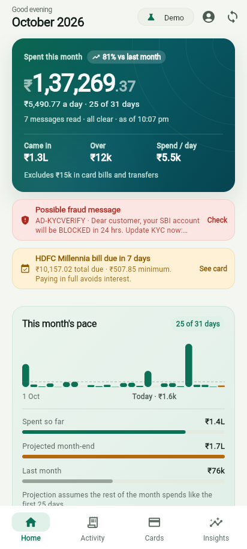

# Hisaab

**An offline spending companion for India, built on the transaction alerts already sitting in your SMS inbox.**

No bank credentials. No account. No server. Every message is parsed on the phone, and the app explains every number it shows.



---

## The problem it solves

Indian spending is fragmented across UPI, three cards, wallets and autopay, and the only complete record of it is the SMS inbox. Existing SMS readers fail in predictable ways:

| Failure | What this app does instead |
|---|---|
| Books "debited ₹250, Avl Bal ₹9,500" as a ₹9,500 spend | Scores every amount by its context (verb proximity, balance/limit words, OTP and date patterns) and picks one |
| Counts a credit-card bill payment as new spending | Classifies card bills, self-transfers, wallet loads, SIPs and EMIs as *transfers*, excluded from spend totals |
| Counts the same payment twice (bank alert + card alert) | Content-hash identity plus a conservative cross-alert merge engine |
| Treats phishing as a transaction | Weighted classifier separates transactions, OTP/info, marketing and fraud — a credential ask always overrides sender trust |
| Reports "utilisation 0%" because it never knew your limit | Utilisation model with statement-cycle awareness, limit from the alert or entered once by the user |
| Shows a scary red number with no explanation | Every figure has an origin: the raw SMS, the parsed fields, the confidence, and a plain-English reason |

## What it does

**Home** — month spend with projection, month-over-month, income vs spend, category split, card pressure, insights, recent activity.
**Activity** — every payment and credit grouped by day, searchable, filterable, with a detail sheet showing the source SMS and parse confidence.
**Cards** — per-card utilisation against the statement cycle, bill due countdown, minimum due, projected utilisation, and 30%-line headroom.
**Insights** — category spikes, possible duplicate charges, recurring payments and their annualised cost, savings rate, small-spend leakage.
**Fraud protection** — KYC/refund/parcel scam detection, quarantined away from your totals, with the reason shown on demand.
**Quick classify** — tap a category on the Android notification and the payment is already categorised when you next open the app.

## How the parsing works

```
SMS inbox ──┐
            ├─► sms_messages ─► SmsClassifier ─► (transaction) ─► TransactionExtractor ─► Categorizer ─► transactions
receiver ───┘   (raw only)      │  weighted signals                │  amount scoring             │
                                └─► informational / promo / fraud  └─► card bill notices         └─► dedupe ─► engines ─► UI
```

1. **One parser.** The Android receiver only stores raw SMS (`RawSmsStore`); Dart owns classification, extraction and the `transactions` table. This removes the class of bugs where a Kotlin copy and a Dart copy of the same rules drift apart.
2. **Sender trust** (`sender_registry.dart`): DLT headers (`VM-HDFCBK-T`) are decomposed into prefix, entity and category; a curated registry maps ~90 bank/wallet codes to names; numeric, `+91` and homoglyph-lookalike senders score as suspicious.
3. **Classification** (`sms_classifier.dart`): ~25 weighted signals (debit verb, credit verb, amount present, OTP wording, DLT promotional header, KYC lure, credential ask, suspicious link, money request, mandate setup) resolved into `transaction | informational | promo | phishing | unknown`, with the signals kept for the UI.
4. **Amount scoring** (`amount_finder.dart`): every `₹`/`Rs`/`INR` number is scored by its 60-character context, so balance, limit, OTP, date and card-number digits lose to the transaction amount.
5. **Extraction** (`transaction_extractor.dart`): direction, instrument, merchant/VPA, card last-4 and issuer, reference id, balance after, available limit, and card bill notices (total due / minimum due / due date).
6. **Dedupe** (`dedupe_engine.dart`): same amount, within 3 minutes, different sender, matching card or merchant → the richer alert wins, the other is marked (never deleted, so it stays inspectable).
7. **Engines**: `MonthlySummary`, `CardMetrics`, `RecurringDetector`, `InsightsEngine` — pure Dart, unit-tested, no I/O.

## Architecture

```
lib/
  app/            design tokens, theme, shared widget kit
  domain/         money (paise), enums, SMS + transaction models, hashing, category catalogue
  services/       sms/{sender_registry, sms_classifier, amount_finder, transaction_extractor}, categorizer
  data/           sqlite schema + repository, demo dataset/repository, HomeData snapshots
  engine/         monthly summary, card metrics, dedupe, recurring, insights
  state/          AppState (single ChangeNotifier the UI talks to)
  views/          home, activity, cards, insights, settings, onboarding
android/          RawSmsStore + receiver (stores raw SMS, posts quick-classify notification)
```

**Money is always `int` paise.** Never `double` — a paisa lost in rounding breaks equality and dedupe.

## Running it

```powershell
flutter pub get
flutter test                 # parser corpus, engines, widget smoke tests
flutter analyze              # zero issues expected
flutter build apk --debug    # the only supported build
```

**Android only.** The web and desktop targets are not supported: there is no SMS
inbox to read, and the browser's number semantics differ from the phone's (a
64-bit clamp can silently become zero under dart2js). Verification therefore runs
on a device:

```powershell
powershell -File tool/device_shots.ps1   # four tabs + settings -> docs/shots/device-*.png
```

The web build and the onboarding screen both offer **demo data**: a generated 4-month dataset (three cards, rent, SIP, subscriptions, a duplicate charge, a phishing message) so the whole app can be judged without granting SMS access.

## Privacy

- No network calls. No analytics. No account.
- Raw SMS stays in the app's private database and is never uploaded.
- Only `READ_SMS` / `RECEIVE_SMS` / `POST_NOTIFICATIONS` are requested, each with a visible reason.
- Links inside messages are never opened by the app.

## Known constraints

- **`READ_SMS` is a Play-restricted permission.** Google grants it to default-SMS-handler apps; a consumer release needs either that role, a Notification-Listener-based ingestion path, or an import-only build. Ingestion is deliberately behind `SmsInboxReader` so the source can change without touching the parser.
- Bank templates are inferred from public samples; a real release should keep refining them against captured messages. Unrecognised templates still parse the amount and mark the row for review rather than dropping it.
- No credit-score reproduction, no lending, no investment advice — the app reports what happened, not what to do with your money.

## Tests

- `test/sms_corpus_test.dart` — ~100 real/inferred bank messages with expected amount, direction, instrument, card and merchant.
- `test/spam_corpus_test.dart` — OTP / promo / phishing classification with per-bucket pass rates.
- `test/engine_test.dart` — summary maths, utilisation bands and cycles, dedupe rules, recurring detection, money formatting.
- `test/widget_smoke_test.dart` — the whole app pumps at 360×800 with 1.3× text and no overflow.

Research that shaped the rules lives in `docs/research/` (Indian SMS corpus, spam & phishing, credit semantics, UX spec).
